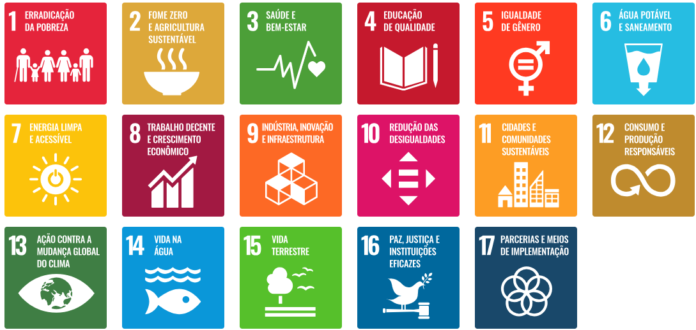

# PTCC

Repositório criado para organizar o desenvolvimento do **Projeto de Trabalho de Conclusão de Curso (PTCC)**.

## Objetivo

Este repositório será utilizado para armazenar materiais, ideias, pesquisas, documentos e arquivos relacionados ao desenvolvimento do projeto.

## Organização

Ao longo do desenvolvimento poderão ser adicionados:

- definição do tema;
- integrantes do grupo;
- pesquisas;
- documentação;
- protótipos;
- código-fonte;
- apresentações;
- relatórios;
- materiais do TCC.

## Status

Projeto em fase inicial de planejamento e definição.

## Autor

Pedro Akio Sakuma